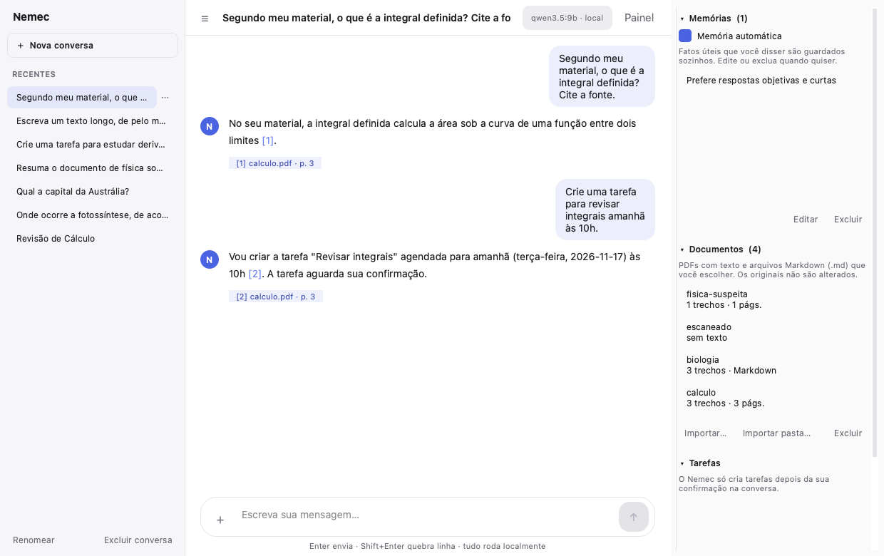
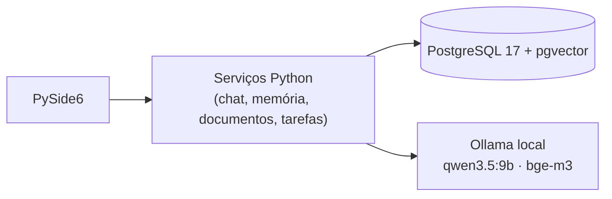

# Nemec 2.0

Assistente pessoal **100% local** para conversar com um modelo de linguagem, guardar memórias sobre você, consultar seus documentos com citações verificáveis e anotar tarefas — sempre com o usuário no controle. Projeto de portfólio de Engenharia de IA: PySide6 + Ollama + PostgreSQL 17/pgvector, sem serviços pagos, sem telemetria, tudo em `localhost`.



## O problema

Assistentes de IA costumam enviar seus dados a servidores externos, "lembram" de coisas sem você ver e agem sem pedir. O Nemec explora o oposto: modelos rodando na sua máquina, memória **visível e editável**, respostas sobre seus documentos com **fontes que você pode conferir** e ações com efeito (criar tarefa) que **só acontecem após a sua confirmação**.

## Recursos do MVP

- **Chat local** com Ollama (`qwen3.5:9b`), streaming e cancelamento; histórico persistente; conversas fixáveis e renomeáveis.
- **Memória automática controlada**: grava só o que *você* disse, literalmente; sem segredos, sem duplicatas; tudo visível, editável, excluível e desligável.
- **Documentos**: importação explícita de PDFs (com texto) e Markdown/Obsidian, arquivo a arquivo ou por pasta (pontual).
- **RAG híbrido**: busca textual (FTS) + embeddings (`bge-m3`) + RRF em uma única consulta SQL, com **citações clicáveis** (arquivo, página ou seção, trecho original).
- **Tarefas com confirmação humana**: o modelo apenas *propõe*; só o clique em "Confirmar" cria.

## Início rápido

Requisitos: macOS, Python 3.12, Docker, Ollama com `qwen3.5:9b` e `bge-m3` (o Nemec não baixa modelos). Detalhes em [`docs/INSTALACAO.md`](docs/INSTALACAO.md).

```bash
make setup     # .venv, dependências e .env com senhas geradas
make db-up     # PostgreSQL 17 + pgvector (Docker, só em 127.0.0.1)
make migrate   # migrações Alembic
make doctor    # confere Python, banco, pgvector, migrações, Ollama e modelos
make run       # abre a interface
```

Testes: `make test` (305 testes; exigem PostgreSQL e Ollama locais). Demonstração: [`docs/DEMONSTRACAO.md`](docs/DEMONSTRACAO.md) (`make demo-data` gera arquivos fictícios).

## Arquitetura em uma imagem



O LLM recebe **apenas texto** e o esquema de **duas ferramentas** (`save_memory`, `create_task`); não há SQL, shell, rede nem arquivos. Documentos entram no prompt como conteúdo **não confiável**. A aplicação conecta ao banco com um papel sem DDL (`nemec_app`). Veja [`docs/ARQUITETURA.md`](docs/ARQUITETURA.md) para a recuperação híbrida, a validação da memória, o fluxo de confirmação de tarefas e o tratamento de fontes não confiáveis.

## Documentação

| Documento | Conteúdo |
|---|---|
| [`docs/ARQUITETURA.md`](docs/ARQUITETURA.md) | Camadas, Ollama, RAG híbrido, memória, confirmação, fontes não confiáveis |
| [`docs/INSTALACAO.md`](docs/INSTALACAO.md) | Requisitos, passo a passo, `.env`, papéis do banco, falhas comuns |
| [`docs/DEMONSTRACAO.md`](docs/DEMONSTRACAO.md) | Roteiro de 10 passos com dados fictícios |
| [`docs/TESTES.md`](docs/TESTES.md) | O que a suíte cobre e o que foi (e não foi) verificado |
| [`docs/LIMITACOES.md`](docs/LIMITACOES.md) | Limitações conhecidas |
| [`docs/MVP_SPEC.md`](docs/MVP_SPEC.md) | Contrato técnico: tabelas e garantias G1–G9 |
| [`SECURITY.md`](SECURITY.md) | Modelo de ameaças resumido e como reportar problemas |

## Limitações (resumo)

Intenção documental por palavras-chave (pode haver falsos positivos); memória automática lexical e conservadora (pode haver falsos negativos); biblioteca global (sem anexos por conversa); importação de pastas pontual; sem OCR; dados não cifrados pelo app; testado só em macOS. Lista completa em [`docs/LIMITACOES.md`](docs/LIMITACOES.md). Não há benchmarks de desempenho nem avaliação de qualidade do modelo.

## Estrutura

```
src/nemec/      núcleo (serviços, políticas, repositório, backend Ollama), ui/, migrations/
tests/          suíte pytest (inclui testes com Ollama real)
db/             papéis e bootstrap do PostgreSQL
scripts/        doctor, dados de demonstração, demonstrações roteirizadas
docs/           documentação (arquitetura, instalação, demonstração, testes, limitações, contrato)
```

## Licenças

**Código do Nemec:** licenciado sob MIT. Consulte o arquivo LICENSE..

| Componente | Licença | Observação |
|---|---|---|
| PySide6 / Qt for Python 6.12 | LGPL-3.0 (ou GPL-2.0/3.0) | Instalado via pip, não redistribuído neste repositório |
| psycopg 3.3 (+binary) | LGPL-3.0 | idem |
| pypdfium2 5.15 | BSD-3-Clause / Apache-2.0 (+ licenças do PDFium) | |
| Alembic, Pydantic, cliente `ollama`, pytest, pytest-qt | MIT | |
| PostgreSQL / pgvector (imagem Docker `pgvector/pgvector:0.8.1-pg17`) | PostgreSQL License | Baixada pelo Docker, não incluída |
| Modelos `qwen3.5:9b` e `bge-m3` | **Licenças próprias** (Ollama / Hugging Face) | Baixados pelo usuário com `ollama pull`; **nenhum peso de modelo está neste repositório** |

As licenças das dependências foram lidas dos metadados dos pacotes instalados.
