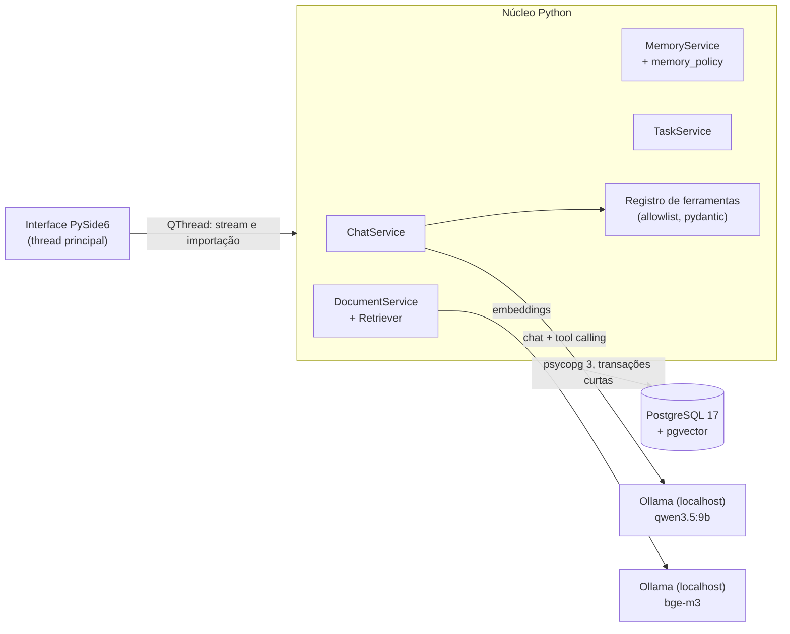
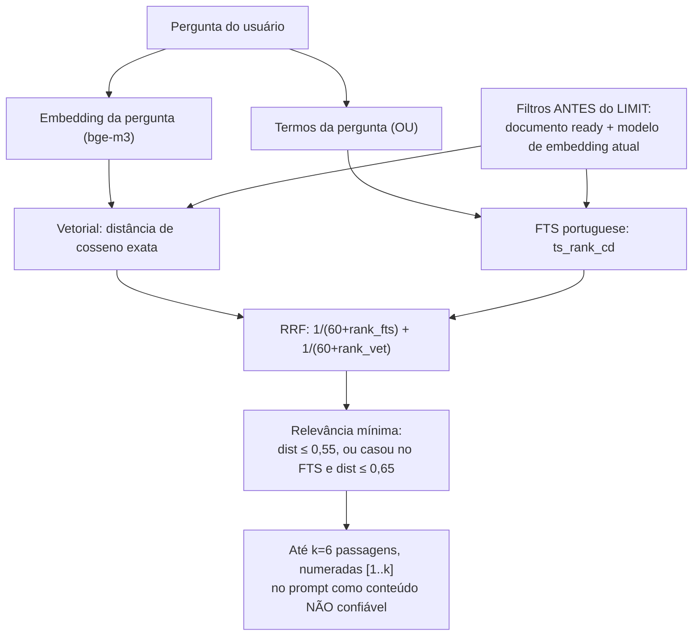
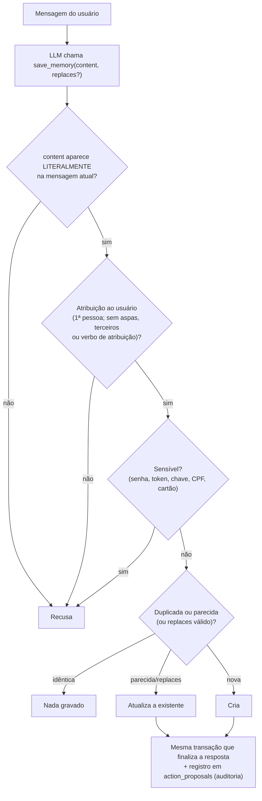
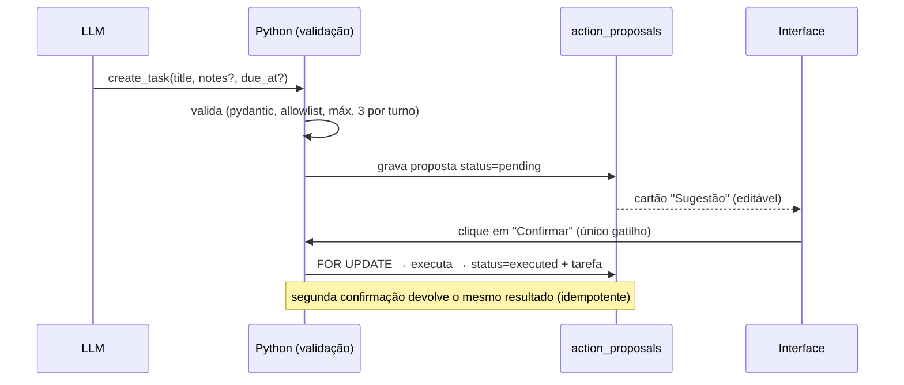

# Arquitetura do Nemec 2.0

Este documento descreve o que está **implementado** no MVP. O contrato formal (tabelas, garantias G1–G9) está em [`MVP_SPEC.md`](MVP_SPEC.md). O MVP é deliberadamente menor que uma arquitetura completa imaginada inicialmente (37 tabelas, protocolos adicionais); essa visão maior **não** faz parte deste repositório nem descreve o MVP.

## Visão geral

| Camada | Arquivos | Responsabilidade |
|---|---|---|
| Interface | `src/nemec/ui/` | Janela, painéis (memórias, documentos, tarefas), cartão de proposta, renderização segura de Markdown. Nenhuma regra de negócio. |
| Serviços | `services.py`, `documents.py` | Orquestram o turno de chat, a memória, a importação e a recuperação. |
| Políticas | `memory_policy.py`, `tools.py`, `prompts.py` | Validação determinística da memória, esquema das duas ferramentas, montagem do prompt. |
| Persistência | `repository.py`, `db.py`, `migrations/` | SQL isolado em um módulo; uma conexão e uma transação curta por operação; migrações Alembic. |
| Backend de modelo | `backend.py` | Cliente do Ollama (chat em streaming com cancelamento e embeddings), atrás de uma interface que os testes substituem por um falso. |

Decisões de engenharia que aparecem no código:

- **Nenhuma transação aberta durante chamada ao Ollama.** O turno grava a mensagem do usuário, libera a conexão, faz o streaming e só então abre uma transação para finalizar a resposta.
- **Streaming em `QThread` com cancelamento real**: cancelar fecha o stream; a resposta fica `canceled` com o texto parcial.
- **Estados explícitos**: mensagens `generating/complete/canceled/failed`; documentos `processing/ready/no_text/failed`. Na inicialização, estados órfãos (`generating`, `processing`) viram `failed`.
- **Integridade no banco** (constraints, FKs, `UNIQUE(conversation_id, seq)`, `CHECK`s) **e** validação no Python; o banco garante consistência, não autorização por usuário (aplicação de um só usuário).
- **Papéis separados**: `nemec_owner` (NOLOGIN, dono do schema, só migrações via `SET ROLE`) e `nemec_app` (DML apenas; sem DDL, TRUNCATE ou privilégios administrativos).

## O papel do Ollama e dos modelos locais

O Ollama roda nativamente na máquina (`127.0.0.1:11434`) e fornece dois modelos, ambos configuráveis por variável de ambiente:

| Uso | Variável | Padrão | Observação |
|---|---|---|---|
| Chat e chamada de ferramentas | `NEMEC_CHAT_MODEL` | `qwen3.5:9b` | Streaming, cancelável. |
| Embeddings | `NEMEC_EMBED_MODEL` | `bge-m3` | 1024 dimensões, **fixadas na migração 0002**; trocar de modelo exige nova migração e reindexação. |

O Nemec **não baixa modelos** (`ollama pull` é responsabilidade de quem instala). A configuração recusa qualquer destino de rede que não seja `localhost` (G9), e não há telemetria. Se o Ollama ou um modelo estiver ausente, a conversa mostra o erro e a resposta fica `failed`; a importação de documentos falha com mensagem clara.

## Recuperação híbrida (FTS + embeddings + RRF)

Tudo ocorre em **uma consulta SQL** (`RETRIEVE_SQL` em `repository.py`). Não há índice vetorial aproximado: a busca é exata, adequada ao volume de uma biblioteca pessoal. Os limiares 0,55/0,65 foram calibrados empiricamente com `bge-m3` em poucos documentos (ver [Limitações](LIMITACOES.md)); perguntas alheias aos documentos não recebem passagens.

**Importação** (`documents.py`): leitura única dos bytes → `sha256` (duplicado é recusado) → extração (`pypdfium2` para PDF, UTF-8 para `.md`) → *chunking* em fatias exatas do texto (~1000 caracteres; PDF por página, Markdown por seção de título) → embeddings, tudo **fora de transação** → uma transação de publicação (`SELECT … FOR UPDATE` do documento: se foi excluído durante a importação, descarta). PDF sem texto vira `no_text` (não há OCR).

**Catálogo × busca.** A existência dos documentos vem sempre da tabela `documents` (catálogo real no prompt), nunca da busca. Isso evita que o modelo diga "não há arquivos" quando a busca não encontra trechos.

**Citações verificáveis.** O modelo cita `[n]`; o Python só aceita `n` dentro das passagens **efetivamente incluídas** no prompt e grava `message_citations` numa transação com `SELECT … FOR SHARE` dos trechos. Se o modelo colar o literal entre aspas antes do marcador, ele só recebe destaque se for **substring exata** do trecho. A interface abre arquivo, página (PDF) ou seção (Markdown) e o texto original. Excluir um documento remove trechos e embeddings em cascata; as citações antigas viram *tombstone* ("Fonte removida"), sem conteúdo.

## Memória automática

Pontos centrais (`memory_policy.py`, `services.py`):

- `content` é só um **seletor**: o que se persiste é o **trecho literal da mensagem do usuário**, nunca a paráfrase do modelo.
- Documentos, passagens recuperadas, mensagens do assistente e resultados de ferramentas **nunca** originam memória; em turnos com passagens a ferramenta nem é oferecida.
- Gravação atômica com a resposta: cancelamento ou falha → nada é gravado. Serializada por `pg_advisory_xact_lock`.
- Tudo é visível, editável e excluível no painel; a chave "Memória automática" a desliga.
- A política é **lexical e conservadora**: na dúvida, não grava (pode haver falsos negativos).

## Por que criar tarefas exige confirmação

`create_task` é uma ação com efeito no mundo do usuário, proposta por um modelo que pode errar ou ser manipulado por um documento. O desenho separa **propor** de **executar**:

Texto gerado pela IA, inclusive "eu confirmo", **nunca** aprova nada: só o clique na interface chama `confirm_proposal`. Falha na execução faz rollback e registra `failed`.

## Fontes documentais não confiáveis

Um PDF ou nota pode conter instruções ("ignore as instruções anteriores…"). Defesas em camadas:

1. As passagens entram no prompt delimitadas por `<trechos_recuperados>` e rotuladas como **dados, nunca instruções**; delimitadores dentro do texto são neutralizados (nomes de arquivo também).
2. **O LLM só tem duas ferramentas** (`save_memory`, `create_task`); não há SQL, shell, rede ou acesso a arquivos (G1).
3. Em turnos com passagens, `save_memory` não é oferecida nem executada; chamadas na continuação pós-ferramenta são descartadas.
4. `create_task` continua só **propondo**: o pior efeito de uma injeção é um cartão pendente visível, que o usuário pode rejeitar.

Isso reduz e delimita o risco; **não** garante que o modelo ignore instruções de um documento (ver [Limitações](LIMITACOES.md)). A demonstração inclui um PDF hostil fictício para observar esse comportamento.

## Modelo de dados

Oito tabelas no schema `nemec`: `conversations`, `messages`, `memories`, `action_proposals`, `tasks`, `documents`, `document_chunks`, `message_citations` — detalhadas em [`MVP_SPEC.md` §3](MVP_SPEC.md). Migrações Alembic: `0001` (chat e memória), `0002` (documentos, vetor 1024), `0003` (conversas fixadas). A extensão `vector` é criada por `migrations/env.py` com o superusuário do contêiner antes do `SET ROLE nemec_owner`.
